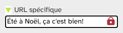
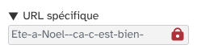

# Clean URLs : guide d'utilisation

Ce guide explique ce que fait le plugin _Clean URLs_ sur les adresses de vos billets.

Ce plugin n'a pas de page d'administration et n'ajoute rien sur le blog. Il agit tout seul, sans réglage.

## Sommaire

* [À quoi sert le plugin](#à-quoi-sert-le-plugin)
* [Utiliser le plugin](#utiliser-le-plugin)
* [Ce qui est nettoyé](#ce-qui-est-nettoyé)
* [Exemples](#exemples)
* [Bon à savoir](#bon-à-savoir)

## À quoi sert le plugin

Quand vous donnez vous-même l'adresse d'un billet, Dotclear la garde telle quelle : accents, ponctuation, espaces. Ce n'est pas joli dans un navigateur.

_Clean URLs_ nettoie cette adresse au moment de la création du billet : plus d'accents, plus de ponctuation.

## Utiliser le plugin

1. Installez et activez le plugin.
2. Créez un billet. Dans le panneau de droite, ouvrez _URL spécifique_ puis cliquez sur le cadenas pour déverrouiller le champ.
3. Saisissez l'adresse voulue.

4. Enregistrez le billet.

L'adresse est nettoyée à l'enregistrement :

Si vous laissez le champ vide, Dotclear fabrique déjà une adresse propre à partir du titre. Le plugin ne change rien dans ce cas.

## Ce qui est nettoyé

* **Les lettres accentuées** deviennent leur lettre simple : `é`, `à`, `ç`, `ñ`, `å` donnent `e`, `a`, `c`, `n`, `a`. Les ligatures sont développées : `œ` donne `oe`, `æ` donne `ae`, `ß` donne `ss`.
* **Ces signes** deviennent un tiret : `,` `!` `.` `?` `;` `:` `@` `$` `«` `»` `°` `*`.

Les apostrophes et les espaces sont déjà remplacés par un tiret par Dotclear.

## Exemples

| Adresse saisie | Adresse enregistrée |
|----------------|---------------------|
| `Été à Noël, ça c'est bien!` | `Ete-a-Noel--ca-c-est-bien-` |
| `L'Œuvre.d'Ångström;ß` | `L-OEuvre-d-Angstrom-s` |
| `Ünïcödé.Ñandú?` | `Unicode-Nandu` |

Sans le plugin, la première adresse serait enregistrée avec ses accents et sa ponctuation.

## Bon à savoir

* Le nettoyage n'a lieu qu'à la **création** du billet. Si vous modifiez l'adresse d'un billet existant, elle est enregistrée telle quelle.
* Les billets déjà publiés ne sont pas modifiés.
* Les lettres d'autres alphabets (japonais, cyrillique…) ne sont pas converties. Elles restent dans l'adresse.
* Les majuscules restent des majuscules, et les tirets en double ou en fin d'adresse ne sont pas supprimés.
* Une adresse composée seulement de signes de la liste devient une suite de tirets (`.,;` donne `---`).
* Le plugin ne touche pas aux adresses des catégories ni des pages.
